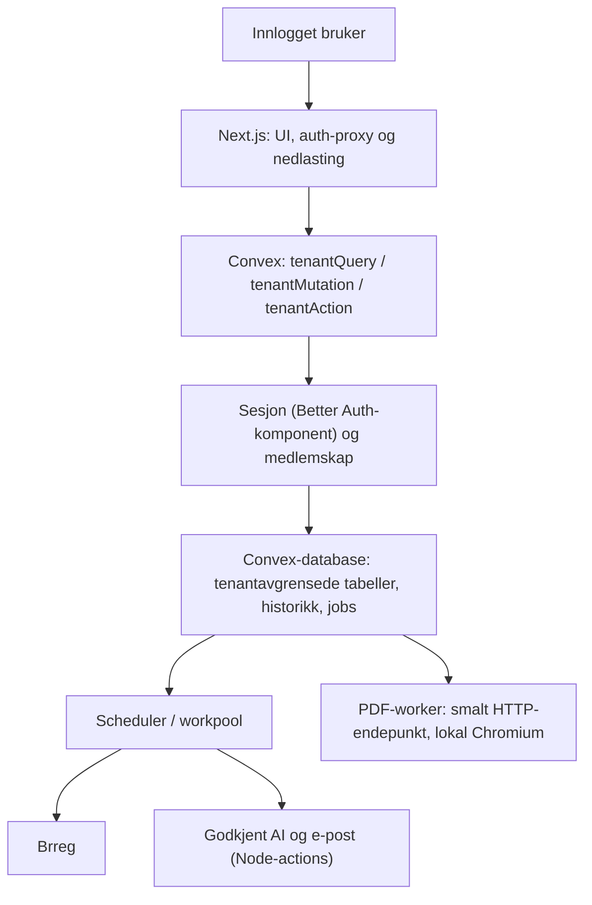

# Teknologi og arkitektur

Vedtatt stack per 6. november 2026, se [beslutning 0001](decisions/0001-convex-eu.md). Dette beskriver målbildet, ikke et ferdig bygget repo. Prosjektet er egnet for to utviklere på deltid: ett språk, én kodebase, Convex som backend og Next.js som grensesnitt.

| Del | Valg | Begrunnelse |
|---|---|---|
| Grensesnitt | Next.js App Router, React, TypeScript strict, Node 24 LTS | Kjent React/TS-arbeidsflyt; serverkomponenter og route handlers for innlogging og nedlasting |
| UI | Tailwind, shadcn/ui, Zod, React Hook Form ved behov | Raskt konsistent norsk skjema- og tabellgrensesnitt |
| Backend og database | Convex (skjema, queries, mutasjoner, actions, scheduler, fillagring) | Typede funksjoner, transaksjonelle mutasjoner og lite drift |
| Hosting av data | Convex Cloud `aws-eu-west-1` (Irland) for staging/prod; åpen Convex-backend i Docker lokalt og i CI | EU-region uten egen databasedrift; selvhosting på EU-VPS mulig senere |
| Innlogging | Better Auth via `@convex-dev/better-auth`, e-post/passord, egne `memberships` | Etablert authbibliotek; auth-tabeller i egen komponent atskilt fra forretningsdata |
| Bakgrunn | Convex scheduler + `@convex-dev/workpool` + `jobs`-tabell | Varige retries og status uten Redis eller egen kø |
| AI | Egen adapter i Convex Node-actions; fake/av først. Azure OpenAI med dokumentert EU-behandling som kandidat | Leverandør kan byttes uten å endre domene |
| PDF | Egen Node-worker med Playwright/Chromium, lokal HTML/CSS og font | Convex-actions kan ikke kjøre Chromium; god kontroll over norsk A4-layout |
| E-post | Nodemailer i Convex Node-action + EU/EØS-godkjent SMTP, Scaleway TEM som kandidat | Trengs allerede til invitasjon/passordreset |
| Test | Vitest, `convex-test`, integrasjon mot lokal Convex-backend, Playwright | Ren logikk, funksjoner og faktisk tenantvern testes på riktig nivå |
| Drift | Convex Cloud EU; Next.js og PDF-worker hos EU/EØS-leverandør (avgjøres i oppgave 25) | Få bevegelige deler; dataplassering valgt eksplisitt |
| CI | GitHub Actions med bare syntetiske data og lokal Convex-backend | Lint, typer, deploy til tom backend, tester og build før merge |

Versjoner låses i oppgave 01 og oppdateres kontrollert. Ikke bruk gamle oppskrifter ukritisk; særlig Next.js-API-er, Better Auth-komponenten (under 1.0) og Convex sine hjelpebibliotek må sjekkes mot valgte versjoner.

## Dataflyt og grenser

Next.js er grensesnittet. Klientkomponenter bruker Convex React-klienten med brukerens token; serverkomponenter bruker `fetchAuthQuery`/`fetchAuthMutation` fra Better Auth-integrasjonen. Route handlers brukes til Better Auth-proxy (`/api/auth/[...all]`) og binære nedlastinger. Next.js har aldri Convex deploy/admin key og har ingen egen databasetilgang. All forretningslogikk og autorisasjon ligger i Convex-funksjoner eller ren kode i `src/domain/`. Nettleseren får aldri AI-nøkler eller interne funksjoner.

## Tenant- og auth-design
En Organization er en kunde/workspace og dekker én juridisk virksomhet i MVP. En User kan ha Membership i flere organisasjoner; kun `admin` er redigerende kunderolle i MVP. Ingen plattformadministrasjon i kundegrensesnittet. Leverandører og styremedlemmer har ingen egne kontoer i MVP.

Invitasjonsbasert pilot holder onboarding liten. Operatør oppretter kundens workspace via en dokumentert intern Convex-funksjon kjørt med operatørlegitimasjon (`npx convex run ops/...`). Appen tilbyr ikke åpent org.nr.-basert eierskap: kjennskap til organisasjonsnummer beviser ikke fullmakt. Kontroller mottakerens tilhørighet ved pilotopprettelse. Ingen automatisk tilgang til andre kunder med samme e-postdomene. Åpen registrering er slått av i Better Auth.

Tilgangsgrensene i Convex:
1. **Operatør/deploy:** deploy key og admin key. Skjema, funksjoner, interne funksjoner, bootstrap og risikodataimport. Brukes bare i CI-deploy og av navngitte operatører.
2. **Auth:** Better Auth-komponentens egne tabeller (bruker, sesjon, konto, verifisering). Appens kode leser bare autentisert bruker via komponentens API; komponenten har ingen tilgang til forretningstabeller.
3. **Tenantfunksjoner:** offentlige funksjoner laget med `tenantQuery`/`tenantMutation`/`tenantAction`. De verifiserer bruker → aktivt medlemskap → rolle og gir en innpakket `ctx.db` som avviser dokumenter med annen `organizationId`.
4. **Scheduler/jobs:** planlagte funksjoner er interne og mottar `organizationId` og jobb-id fra en mutasjon som allerede har verifisert tenant. Jobbhandler laster jobben, kontrollerer at objektreferanser tilhører samme organisasjon, og skriver resultat via en intern mutasjon med samme kontroll.
5. **PDF-worker:** egen hemmelighet (`PDF_WORKER_SECRET`) mot to smale HTTP-endepunkter i `convex/http.ts` (hent neste jobbs renderingsgrunnlag, lever resultat). Workeren får bare data for den jobben den har fått tildelt, og har aldri deploy/admin key.

Convex har ikke radpolicyer, databaseroller eller fremmednøkler. Tenantvernet er byggeklossene, `getOwned`-kontrollen av referanser, ESLint-regelen mot rå funksjoner og negative integrasjonstester. RLS-hjelperen fra `convex-helpers` er et ekstra vern i applikasjonslaget. En kompromittert deploy key eller feil i en intern funksjon er ikke avverget av dette; begrens og roter nøkler, og hold interne funksjoner små.

## Jobber, lagring og robusthet
`jobs`-tabellen brukes for Brreg-batch, AI og PDF, med `organizationId`, type, idempotencyKey, status, attempts, maxAttempts, runAfter, inputRef og errorCode. En tenantmutasjon oppretter jobben (idempotent på `(organizationId, type, idempotencyKey)`) og planlegger arbeidet via workpool. Eksterne kall skjer i actions med timeout og begrenset retry; resultatet skrives i en ny intern mutasjon som kontrollerer tenant på nytt. Convex-mutasjoner er transaksjonelle og retries ved konflikt, men actions er ikke exactly-once: bruk idempotente resultater og kostnadsgrenser. PDF-jobber hentes av PDF-workeren gjennom det smale endepunktet; utløpt tildeling gjør jobben tilgjengelig igjen.

Små importer (maks 2 MiB / 2 000 rader) sendes som bytes til en `tenantAction`, parses i minne og lagres som validerte rader i batcher innenfor Convex sine transaksjonsgrenser. Råfil lagres aldri. PDF lagres i Convex file storage med metadata i `pdfExports`; kundens rånavn brukes aldri som filnavn. Ingen `storage.getUrl`-lenker gis til klienter: nedlasting går via en Next.js route handler eller HTTP-action som verifiserer medlemskap og rapporttilknytning før filen strømmes med `no-store`. Convex-eksport (data + filer) er backupenheten og må prøves gjenopprettet.

## Risikometode v0: screening som kan forklares
Metoden er et produktforslag som krever faglig review før reell bruk. Den er ikke en offisiell algoritme fra åpenhetsloven. CountryRisk og IndustryRisk er versjonerte datasett, atskilt fra metodekonfigurasjonen. Regler har egne stabile ruleId-er. Bransjekode lagres med SN/NACE-versjon; kjøpt produkt kan ha høy risiko selv om leverandørens hovednæring ikke viser det. Selve motoren er ren TypeScript i `src/domain/risk/` uten Convex- eller Next.js-avhengigheter.

Start med ordinal prioritering, ikke et vilkårlig 0–100-tall. Hver relevant faktor gir lav/moderat/høy eller mangler. Høy kjent faktor gir høy screening; ellers gir vesentlige datamangler ukjent; ellers høyeste kjente nivå. Kontekstuelle kontrollsignaler oppretter oppfølging separat. Beløp sorterer kun innenfor samme nivå. Ukjent vises i egen oppfølgingsliste og faller aldri bak lav risiko på grunn av et nullfelt.

Screening erstatter ikke brukerens vurdering av berørte rettigheter, alvorlighet (omfang/utbredelse/mulighet for gjenoppretting), sannsynlighet, faktiske konsekvenser og oppfølging. Kunden registrerer dette i en enkel struktur. Bare grunnlag som faktisk finnes kan omtales i redegjørelsen. En norsk leverandør skal kunne ha kjente produksjonsland og ukjent oppstrøms risiko.

## EU/EØS og produksjon
Convex-deployments for staging og produksjon opprettes i `aws-eu-west-1` (Irland). Regionen kan ikke endres i etterkant; feil region betyr ny deployment og eksport/import. EU-region er et produktkrav fra prosjektet, ikke en generell påstand om at GDPR alltid krever EU-lagring. Convex Inc. er et amerikansk selskap: DPA, underleverandører, overføringsgrunnlag, supporttilgang, backup- og loggplassering må dokumenteres før ekte kundedata (se beslutning 0001). Next.js og PDF-worker hostes i EU/EØS; valget tas i oppgave 25. E-post og AI trenger egne vurderinger. Microsoft dokumenterer ulike inferensområder for Global, Data Zone og regionale deploytyper; et europeisk ressursnavn alene er utilstrekkelig. Hvis hele kravet ikke kan dokumenteres, lanser med AI av og manuelle maler.

Begynn med separate lokale, staging- og produksjonsdeployments. Før pilot: TLS, begrenset tilgang til Convex-dashboard og deploy keys, regelmessig Convex-eksport lagret kryptert i EU/EØS, restore-prøve til ny deployment, loggminimering, avsenderautentisering, gyldige kundedokumenter og gjennomgåtte risikokilder. Et teammedlem må eie oppdateringer, nøkkelrotasjon og alarmer. Manuell fakturering holder betalingsbehandling utenfor MVP. Overgang til selvhostet Convex på EU-VPS krever egen beslutning, driftsansvar for backend, backup og patching, og en prøvd eksport/import.

## To utviklere
Hver oppgave er en egen branch/PR og en gjennomgåelig vertikal endring. Ikke la begge endre `convex/schema.ts` samtidig. Én eier skjema- og tenantvern-endringer, den andre reviewer. Bruk korte levende `docs/STATUS.md` og `docs/decisions/*.md`, ikke store automatiske dokumentgeneratorer. Oppgaver i planen bygger på forrige; uavhengig UI-/kildereview kan fordeles når kontraktene er stabile, uten at det krever AI-subagenter.
