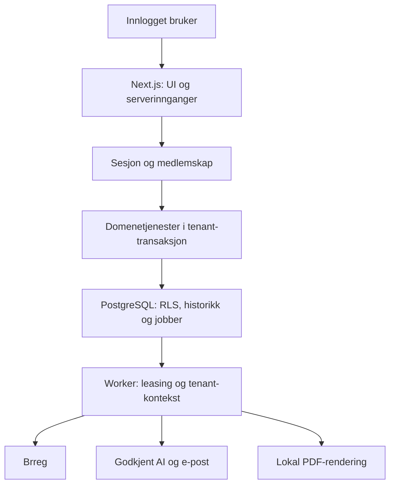

# Teknologi og arkitektur

Dette er et forslag til implementasjon, ikke en påstand om at et repo allerede er bygget. Dato: 6. november 2026. Prosjektet er egnet for to utviklere på deltid: ett språk, én database, ett deploybart system og en liten worker fra samme kodebase.

| Del | Valg | Begrunnelse |
|---|---|---|
| Web/API | Next.js App Router, React, TypeScript strict, Node 24 LTS | UI og serverkode i samme repo; velkjent React/TS-arbeidsflyt |
| UI | Tailwind, shadcn/ui, Zod, React Hook Form ved behov | Raskt konsistent norsk skjema- og tabellgrensesnitt |
| Database | PostgreSQL 18 + Drizzle + SQL-migrasjoner | Enkelt datalager, typed queries, constraints og RLS |
| Innlogging | Better Auth, email/passord, egne Membership-tabeller | Selvhostede sesjoner; færre eksterne dataflyter |
| Bakgrunn | Egen Node-worker + PostgreSQL Job-tabell | Varige retries og status uten Redis; få jobbkategorier i MVP |
| AI | Egen adapter; fake/av først. Azure OpenAI med dokumentert EU-behandling som kandidat | Leverandør kan byttes uten å endre domene; ingen låsing til et globalt endpoint |
| PDF | Playwright/Chromium i worker, lokal HTML/CSS og font | God kontroll over norsk A4-layout og sideskift uten ekstern PDF-tjeneste |
| E-post | Nodemailer + EU/EØS-godkjent SMTP, Scaleway TEM som kandidat | Standardgrensesnitt; e-post trengs allerede til invitasjon/passordreset |
| Test | Vitest + ekte PostgreSQL + Playwright | Rene regler, faktisk RLS og kritiske brukerflyter testes på riktig nivå |
| Drift | Docker Compose, reverse proxy/Caddy, EU-server hos Hetzner | Få bevegelige deler og valgt fysisk lokasjon; medfører eget patch-/backupansvar |
| CI | GitHub Actions eller tilsvarende med bare syntetiske data | Lint, typer, migrasjoner, tester og build før merge |

Versjoner låses ved oppstart og oppdateres kontrollert. Ikke bruk gamle oppskrifter ukritisk; særlig Next.js-API-er, Better Auth-skjema og Drizzle-migrasjoner må sjekkes mot valgte versjoner.

## Dataflyt og grenser

Det er én applikasjon, ikke en separat API-mikrotjeneste. Server Components kan lese via autoriserte tjenester; Server Actions brukes til mutasjoner, Route Handlers til auth og binære nedlastinger. Samme autorisasjon gjelder alle innganger. Browser får aldri direkte SQL- eller AI-tilgang.

## Tenant- og auth-design
En Organization er en kunde/workspace og dekker én juridisk virksomhet i MVP. En User kan ha Membership i flere organisasjoner; kun `admin` er redigerende kundrolle i MVP. Ingen plattformadministrasjon i kundegrensesnittet. Leverandører og styremedlemmer har ingen egne kontoer i MVP.

Invitasjonsbasert pilot holder onboarding liten. Operatør oppretter kundens workspace via en dokumentert administrativ kommando. Appen tilbyr ikke åpent org.nr.-basert eierskap: kjennskap til organisasjonsnummer beviser ikke fullmakt. Kontroller mottakerens tilhørighet ved pilotopprettelse. Ingen automatisk tilgang til andre kunder med samme e-postdomene.

Tre DB-rettighetsgrenser: migrator (DDL), auth/membership (kun identitet og kontrollert onboarding), runtime/worker (RLS på kundedata). Auth-skjema er ikke et alternativt veikryss inn til forretningsdata. Tenantroot og medlemskapsopprettelse må ha eksplisitt dokumentert bootstrap som ikke gir vilkårlig medlemskap. Worker har bare begrenset tilgang til å hente jobbmetadata utenfor tenant-kontekst; hvert domeneoppdrag kjøres inne i tenant. Payload hentes etter at jobben er bundet til riktig organisasjon. Ingen migrasjonsnøkkel i web/worker.

RLS sperrer rader, men gir ikke sikkerhet mot en kompromittert backend som selv kan sette tenant-kontekst. Derfor skal alle innganger ha medlemskapskontroll og parameteriserte spørringer. Policyer testes som runtime, ikke eier/superuser.

## Jobber, lagring og robusthet
Job brukes for Brreg-batch, AI og PDF, med type, tenant, idempotencyKey, status, attempts, runAfter, leaseUntil, lockedBy og inputreferanse. Claim skjer atomisk med SKIP LOCKED i en kort transaksjon. Langt arbeid kjøres uten å holde DB-transaksjon åpen, deretter oppdateres resultat i en ny tenant-transaksjon. Crash gjenopptas etter utløpt lease; eksterne kall har timeout og begrenset retry. Ingen løfter om exactly-once for eksterne kall; bruk idempotente resultater og kostnadsgrenser.

Små importer parses i minne etter fil-/radgrense og lagres som validerte rader i DB. Råfil forkastes. PDF lagres privat på serverdisk med opaque filnavn og DB-metadata; samme grensesnitt kan senere få EU S3-adapter. Kundens rånavn brukes aldri som sti. Nedlastingshandler sjekker medlemskap og rapporttilknytning før lesing. Privatlager og DB må sikkerhetskopieres sammen. Ingen offentlige fil-URL-er.

## Risikometode v0: screening som kan forklares
Metoden er et produktforslag som krever faglig review før reell bruk. Den er ikke en offisiell algoritme fra åpenhetsloven. CountryRisk og IndustryRisk er versjonerte datasett, atskilt fra metodekonfigurasjonen. Regler har egne stabile ruleId-er. Bransjekode lagres med SN/NACE-versjon; kjøpt produkt kan ha høy risiko selv om leverandørens hovednæring ikke viser det.

Start med ordinal prioritering, ikke et vilkårlig 0–100-tall. Hver relevant faktor gir lav/moderat/høy eller mangler. Høy kjent faktor gir høy screening; ellers gir vesentlige datamangler ukjent; ellers høyeste kjente nivå. Kontekstuelle kontrollsignaler oppretter oppfølging separat. Beløp sorterer kun innenfor samme nivå. Ukjent vises i egen oppfølgingsliste og faller aldri bak lav risiko på grunn av et nullfelt.

Screening erstatter ikke brukerens vurdering av berørte rettigheter, alvorlighet (omfang/utbredelse/mulighet for gjenoppretting), sannsynlighet, faktiske konsekvenser og oppfølging. Kunden registrerer dette i en enkel struktur. Bare grunnlag som faktisk finnes kan omtales i redegjørelsen. En norsk leverandør skal kunne ha kjente produksjonsland og ukjent oppstrøms risiko.

## EU/EØS og produksjon
Velg eksplisitt tysk/finsk server og EU/EØS-lagring for DB, filer, backup og logger. Det er et produktkrav fra prosjektet, ikke en generell påstand om at GDPR alltid krever EU-lagring. E-post og AI trenger egne vurderinger. Microsoft dokumenterer ulike inferensområder for Global, Data Zone og regionale deploytyper; et europeisk ressursnavn alene er utilstrekkelig. Undersøk også misbrukslogger, support og kontraktsunntak. Hvis hele kravet ikke kan dokumenteres, lanser med AI av og manuelle maler.

Begynn med separate lokale og stagingmiljøer. Før pilot: TLS, låst DB-port, kryptert backup i EU/EØS, restore-prøve, loggminimering, avsenderautentisering, gyldige kundedokumenter og gjennomgåtte risikokilder. Én server er et bevisst pilotkompromiss med nedetidsrisiko; et teammedlem må eie oppdateringer og alarmer. Manuell fakturering holder betalingsbehandling utenfor MVP.

## To utviklere
Hver oppgave er en egen branch/PR og en gjennomgåelig vertikal endring. Ikke la begge endre samme migrasjoner samtidig. Én eier schema/RLS-endringer, den andre reviewer. Bruk korte levende `docs/STATUS.md` og `docs/decisions/*.md`, ikke store automatiske dokumentgeneratorer. Oppgaver i planen bygger på forrige; uavhengig UI-/kildereview kan fordeles når kontraktene er stabile, uten at det krever AI-subagenter.
