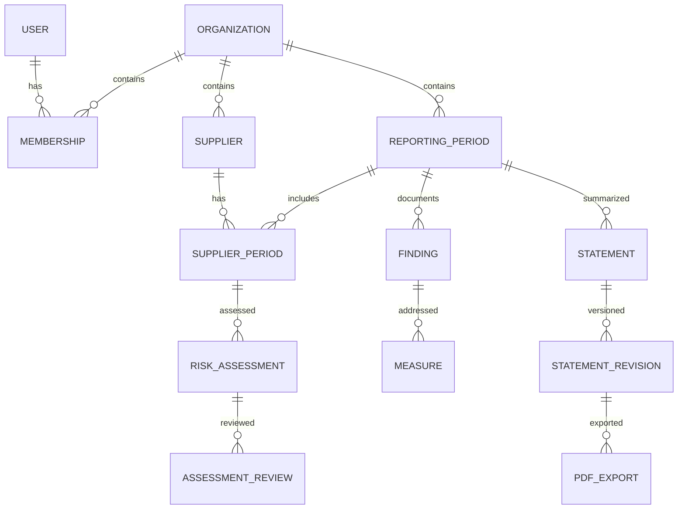

# Datamodell på overordnet nivå

Modellen implementeres som Convex-tabeller i `convex/schema.ts`. Bygg tabellene når oppgaven trenger dem. Convex gir hvert dokument `_id` og `_creationTime`; legg til `updatedAt` og `rowVersion` der dokumenter kan endres. Alle kundeeide tabeller har `organizationId: v.id("organizations")` som påkrevd felt, og alle indekser på dem starter med `organizationId`.

Typer:
- Beløp: `v.int64()` i øre (`bigint` i TypeScript), valuta NOK. Aldri JavaScript-flyttall.
- Tidsstempler: `v.number()` med UTC-millisekunder satt på serveren.
- Kalenderdatoer og rapportperioder: `v.string()` på formen `YYYY-MM-DD`, validert.
- Enumverdier: `v.union(v.literal(...))`.
- Valgfrie felt: `v.optional(...)`. Skill «ukjent» (feltet mangler eller eksplisitt `unknown`) fra «kjent tom/null».
- Objekt-felt (`v.object`) brukes til uforanderlige snapshot og validerte payloads, ikke som erstatning for egne tabeller. Hold dokumenter godt under Convex sin dokumentgrense; store lister blir egne tabeller.

Convex har ikke fremmednøkler eller UNIQUE-constraints. Derfor:
- **Referanser** lagres som `v.id("<tabell>")` og kontrolleres med `getOwned(ctx, table, id)` som avviser dokumenter fra en annen organisasjon før lesing, kobling eller lagring.
- **Unikhet** håndheves med en indeks og oppslag i samme mutasjon. Mutasjoner er serialiserbare, så samtidige forsøk gir konflikt og retry, ikke duplikat. Kolonnen «Unik» under betyr dette.
- **Sletting** av foreldre krever eksplisitt behandling av barn; ingen kaskade.

## Identitet og kunde
| Tabell | Viktige felter | Relasjoner og integritet |
|---|---|---|
| Better Auth (bruker, sesjon, konto, verifisering) | Komponentens faktiske skjema i `@convex-dev/better-auth` | Globale auth-tabeller i komponentens navnerom; ingen kundedata i sesjonen. Appen refererer bruker med Better Auth-brukerens id som streng (`userId`) |
| organizations | name, orgNumber, country, legalForm, status | Tenantrot. Én norsk juridisk virksomhet per workspace i MVP; konsern håndteres som manuell avklaring |
| memberships | organizationId, userId, role, status | User M:N Organization. Unik (organizationId, userId) via indeks `by_org_user`; indeks `by_user` for organisasjonsvelger. Kunde kan ikke velge rolle/medlemskap i request |
| invitations | organizationId, email, tokenHash, expiresAt, acceptedAt, invitedBy | Engangsbruk, utløp, knyttet til riktig verifisert e-post. Ingen råtoken i logg |
| applicabilityAssessments | organizationId, assessedAt, ruleVersion, inputs, result, rationale, userConfirmedAt | Nytt dokument ved ny vurdering. Resultat `likely_in`/`likely_out`/`manual_review`, aldri juridisk garanti |
| reportingPeriods | organizationId, startDate, endDate, publicationDueDate, status, createdAt, createdBy | Datoer som `YYYY-MM-DD`. Ingen antakelse om kalenderår. Unik (organizationId, startDate, endDate) via indeksoppslag i mutasjonen; eksplisitt frist fremfor blind endDate+6m. Status bare `open` i MVP; endres og slettes ikke fra appen |
| businessProfileRevisions | organizationId, reportingPeriodId, revision, organizationDescription, operations, countries, responsibility, policies, routines, stakeholderDialogue, remediationProcess, createdAt, createdBy, confirmedBy/At | Ny rad per lagring, gamle endres aldri. Hvert tema er `{ status, text }` med status `described`/`not_established`/`unknown`, så ukjent, ikke etablert og utfylt holdes fra hverandre. `expectedRevision` stopper overskriving. Se beslutning 0006 |

Applicability-inputs inkluderer regnskapsår for to sammenhengende år, salgsinntekt, balansesum, gjennomsnittlige årsverk, tidligere status, konsern, allmenn interesse og virkeområdespørsmål. Brreg antallAnsatte er ikke det samme som gjennomsnittlige årsverk. Manglende grunnlag gir manuell avklaring. Ikke behandle morselskap som en vanlig isolert enhet i pliktvurderingen.

## Leverandører og import
| Tabell | Viktige felter | Relasjoner og integritet |
|---|---|---|
| suppliers | organizationId, name, nameKey, registryOrgNumber?, externalKey?, registeredCountry?, industryCodeSystem?, industryCode?, status, archivedAt?, rowVersion, createdAt, createdBy | Kundespesifikk leverandør. Manglende felt er ukjent. Unik norsk org.nr. innenfor tenant når satt (indeks `by_organizationId_and_registryOrgNumber`, oppslag i mutasjonen). `externalKey` er også unik innenfor tenant når satt (`by_organizationId_and_externalKey`). Kodeverk og versjon i ett felt. Arkivering sletter ingenting. Samme leverandør i to kunder er to separate dokumenter. Se beslutning 0007 |
| supplierPeriods | organizationId, supplierId, reportingPeriodId, spendOre?, purchaseCategory?, purchaseDescription?, productionCountries[], upstreamUnknown, rowVersion, updatedAt, updatedBy | Unik (organizationId, supplierId, reportingPeriodId) via indeksoppslag i mutasjonen. Beløp i øre (NOK); mangler det, er beløpet ukjent. Tom landliste er ukjent produksjonsland. Hold registerprofil og årets innkjøp adskilt |
| registrySnapshots | organizationId, supplierId? / organizationRef?, source, fetchedAt, selectedFields, sourcePayloadHash, mappingVersion | Minimal valgt datamengde fra Brreg; ingen rolleinformasjon eller fødselsnummer. Snapshot omskriver ikke brukerrettelser |
| importBatches | organizationId, reportingPeriodId, status, idempotencyKey, fileHash, normalizedHash, mappingVersion, fileName, mapping, rowCount, entryCount, kindCounts, policy, rowVersion, createdAt/By, expiresAt, repeatsBatchId?, confirmedAt/By?, nextRowNumber, processed, result, committedAt? | Mottar normaliserte oppføringer, aldri råfil. Status `preparing` → `draft` → `committing` → `committed`. Samme innhold, valg og periode gir samme utkast (`by_organizationId_and_idempotencyKey`). Utløper etter 24 timer hvis ikke bekreftet. Opprettes bare av intern mutasjon fra import-actionen. Se beslutning 0009 |
| importRows | organizationId, batchId, rowNumber, sourceRows[], sourceRowCount, values, issues, kind, matchKind, candidates[{supplierId, rowVersion, periodRowVersion}], decision?, targetSupplierId?, outcome?, supplierId?, previousSpendOre? | Én rad per leverandør i filen (rader med samme org.nr. eller ID er slått sammen). Batch og valgt leverandør kontrolleres med `getOwned`. `candidates` har versjonene fra da grunnlaget ble laget, så endringer etterpå gir konflikt. Resultatfeltene er endringsreferansen for revisjon |

Registreringsland er et felt, ikke produksjonslandets default. Ukjent produksjonsland er en eksplisitt datamangel. `spendOre` kan mangle (ukjent) eller være `0n` (kjent null). Kreditnota/negative innkjøp avklares i importpreview og får ikke redusere risiko. Import oppdaterer årets aggregerte verdi med eksplisitt bekreftelse; den summerer ikke samme fil på nytt. Leverandører uten stabil identifikator får foreslått manuell match, ikke automatisk navnefletting.

## Felles, versjonerte risikodata
Disse tabellene er globalt faggrunnlag, ikke kundedata, og har ikke `organizationId`. Tenantfunksjoner kan bare lese aktiverte, godkjente datasett gjennom egne lesefunksjoner. Ingen kunder kan endre dem. Skriving og aktivering skjer via interne funksjoner kjørt av operatør med deploy/admin key.

| Tabell | Viktige felter | Relasjoner og integritet |
|---|---|---|
| riskDatasetVersions | kind, version, status, environment, sourceUrl, sourceTitle, sourceEdition, retrievedAt, reviewedAt, reviewDueAt, licenseStatus, approvedBy, checksum, schemaVersion | Uforanderlig innhold når godkjent. Demo og production skilles; ingen endring av samme versjon |
| countryRiskEntries | datasetVersionId, iso2, originalIndicator, screeningLevel, transformationNote, sourceReference | Unik (datasetVersionId, iso2). Ingen oppdiktede datapunkter; landdekning måles |
| industryRiskEntries | datasetVersionId, codeSystem, codeVersion, codePrefix? / productCategory?, screeningLevel, sourceReference, rationale | Eksakt mapping har prioritet fremfor prefiks; ugyldige/overlappende regler avvises eller løses eksplisitt |
| riskMethodVersions | version, ruleDefinitions, unknownPolicy, priorityOrder, approvedBy, checksum | Selvstendig metodeversjon, ikke samme ting som kildeutgave |

## Vurderinger og aktsomhetsarbeid
| Tabell | Viktige felter | Relasjoner og integritet |
|---|---|---|
| riskAssessments | organizationId, supplierPeriodId, methodVersionId, countryDatasetVersionId, industryDatasetVersionId, inputSnapshot, inputHash, screeningLevel, dataQuality, missingFields, triggeredRules, assessedAt | Nytt dokument per beregning. Begrunnelser inneholder ruleId, input og datakildereferanser, ikke bare fritekst |
| assessmentReviews | organizationId, assessmentId, actorId, decision, chosenLevel?, rationale, reviewedAt, evidenceNote | Append-only. decision=`confirm`/`override`/`revoke`. Effektiv vurdering beregnes fra gjeldende vurderingshistorikk; original score bevares |
| findings | organizationId, reportingPeriodId, supplierId?, assessmentId?, scope, nature, rightsAffected, description, severityNotes, likelihoodNotes, evidenceNote, status, rowVersion | scope=`own_operations`/`supply_chain`/`business_partner`. nature=`actual`/`potential`. Et screeningnivå blir aldri automatisk et bekreftet funn |
| measures | organizationId, findingId, description, responsibleUserId?, dueDate, status, plannedResult, observedResult, followUpAt, completedAt | Finding 1:N Measure. Skill planlagt handling/forventet resultat fra faktisk gjennomført handling/observert resultat |

Egen virksomhet kan ha Finding uten Supplier. Beskrivelse av berørte interessenter, kommunikasjon og eventuell gjenoppretting kan registreres på funn/profil uten en egen kompleks saksmodul. Henvis til dokumentasjon med korte interne notater i MVP; ikke bygg dokumentopplasting før det er etterspurt. Ikke lagre navn på utsatte arbeidstakere eller sensitive personopplysninger som standard.

## AI, redegjørelse og drift
| Tabell | Viktige felter | Relasjoner og integritet |
|---|---|---|
| aiRuns | organizationId, operation, status, providerConfigVersion, model, promptVersion, inputHash, inputRefs, outputJson?, usage, costEstimate, errorCode, createdBy, jobId | Ikke full promptlogg. Output kan inneholde kundedata og har retention og tenantvern. Avviste/ukjente output brukes ikke videre |
| aiSuggestions | organizationId, aiRunId, targetType/targetId, proposal, sourceRefs, state, decidedBy/At | `pending`/`accepted`/`rejected`. Aksept endrer domenedata via vanlig tenantmutasjon med audit, aldri direkte fra en action |
| statements | organizationId, reportingPeriodId, currentRevisionId?, rowVersion | Ett dokumenthode, mange versjoner. currentRevisionId peker bare til samme tenant og statement |
| statementRevisions | organizationId, statementId, revisionNumber, contentSections, sourceSnapshot, sourceRefs, templateVersion, inputHash, contentHash, origin, aiRunId?, createdBy/At | Uforanderlig. Grunnlag er leverandørtall, vurderinger, profil, funn, tiltak og metodeversjoner fra samme tidspunkt |
| statementReviews | organizationId, revisionId, reviewedBy/At, checklistVersion, acknowledgement | Intern gjennomgang, ikke signatur. Nye data/tekst gjør tidligere review historisk |
| pdfExports | organizationId, statementRevisionId, reviewId?, storageId, bytes, sha256, generatedAt, label, status, jobId | Eksakt revisjon og merking. `storageId` peker til Convex file storage; ingen offentlig URL. Aldri status=signed/published i MVP |
| auditEvents | organizationId, actorType, actorId?, eventType, entityType, entityId, occurredAt, requestId, safeDiff, reason? | Append-only: ingen funksjon oppdaterer eller sletter. entityId kontrolleres mot tenant i hjelperen; loggen overlever arkivering av objektet |
| jobs | organizationId, type, inputRef, idempotencyKey, status, attempts, maxAttempts, runAfter, errorCode?, createdAt, createdBy, finishedAt? | Unik (organizationId, type, idempotencyKey) via indeksoppslag i mutasjonen. Typen må stå i listen over tillatte handlere. `inputRef` kontrolleres med `getOwned` ved opprettelse, start og resultat; payload kan ikke peke til en annen tenant. Status endres bare av interne funksjoner. `leaseUntil`/`lockedBy` kommer med PDF-workeren (oppgave 24). Se beslutning 0010 |
| emailDeliveries | organizationId, messageType, recipientRef, providerMessageId?, status, attempts, sentAt, failureCode | Ingen invitasjons-/resettoken i logg. Auth-relaterte reset-eposter uten tenant holdes i en begrenset auth-leveringslogg uten `organizationId` |

StatementReview og PdfExport er historikk, ikke et nytt juridisk godkjenningssystem. Utkast kan alltid eksporteres med tydelig merking. «Til ekstern signering» krever bekreftet grunnlag og gjennomgang, men er fortsatt usignert. Produksjons- og godkjenningsstatus må ligge eksplisitt i snapshot slik at ingen senere regeloppdatering endrer et tidligere PDF-grunnlag.

## Nøkkelrelasjoner

Diagrammet viser domenet. Import, kildeversjoner, audit og jobber er beskrevet i tabellene. Alle koblinger mellom kundedata kontrolleres med `getOwned` i mutasjonen som oppretter eller endrer koblingen, og RLS-hjelperen avviser i tillegg skriving av dokumenter med feil `organizationId`. Indekser starter med `organizationId` etterfulgt av periode/id/status etter spørringen.
