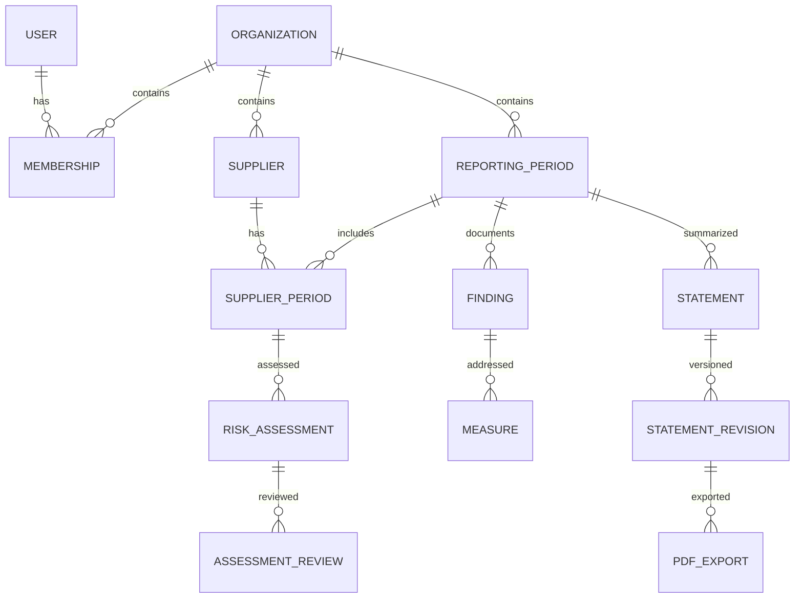

# Datamodell på overordnet nivå

Bygg tabellene når oppgaven trenger dem. UUID-er, `created_at` og relevante `updated_at`/`row_version` brukes gjennomgående. Alle kundeeide entiteter har `organization_id NOT NULL`. Beløp er `bigint` i øre med valuta NOK; ikke JavaScript-flyttall. Tidsstempler er timestamptz, rapportperioder er date. JSONB brukes til uforanderlige snapshot og schemasjekkede payloads, ikke som erstatning for alle relasjoner.

## Identitet og kunde
| Entitet | Viktige felter | Relasjoner og integritet |
|---|---|---|
| User / Session / Account / Verification | Better Auths faktiske skjema | Globale auth-tabeller; ingen kundedata i sesjonspayload |
| Organization | id, name, org_number, country, legal_form, status | Tenantrot. Én norsk juridisk virksomhet per workspace i MVP; konsern håndteres som manuell avklaring |
| Membership | id, organization_id, user_id, role, status | User M:N Organization. UNIQUE(organization_id,user_id). Kunde kan ikke velge rolle/medlemskap i request |
| Invitation | organization_id, email, token_hash, expires_at, accepted_at, invited_by | Engangsbruk, utløp, knyttet til riktig verifisert e-post. Ingen råtoken i logg |
| ApplicabilityAssessment | organization_id, assessed_at, rule_version, inputs, result, rationale, user_confirmed_at | Ny historikkrad ved ny vurdering. Resultat likely_in/likely_out/manual_review, aldri juridisk garanti |
| ReportingPeriod | organization_id, start_date, end_date, publication_due_date, status | Ingen antakelse om kalenderår. Unik avklart periode per tenant; eksplisitt frist fremfor blind end_date+6m |
| BusinessProfileRevision | organization_id, reporting_period_id, revision, organization_description, operations, countries, policies, routines, responsibility, stakeholder_dialogue, remediation_process, confirmed_by/at | Snapshot av egen virksomhet og arbeidet som faktisk er gjort; skille ukjent/ikke etablert/utfylt |

Applicability-inputs inkluderer regnskapsår for to sammenhengende år, salgsinntekt, balansesum, gjennomsnittlige årsverk, tidligere status, konsern, allmenn interesse og virkeområdespørsmål. Brreg antallAnsatte er ikke det samme som gjennomsnittlige årsverk. Manglende grunnlag gir manuell avklaring. Ikke behandle morselskap som en vanlig isolert enhet i pliktvurderingen.

## Leverandører og import
| Entitet | Viktige felter | Relasjoner og integritet |
|---|---|---|
| Supplier | organization_id, id, name, registry_org_number?, external_key?, registered_country, address, industry_code, industry_code_system, industry_code_version, row_version, archived_at | Kundespesifikk leverandør. Delvis unik norsk org.nr. innenfor tenant. Samme leverandør i to kunder er to separate rader |
| SupplierPeriod | organization_id, supplier_id, reporting_period_id, spend_ore, currency, purchase_description, purchase_category, production_countries[], upstream_unknown | Unik(organization_id,supplier_id,reporting_period_id). Hold registerprofil og årets innkjøp adskilt |
| RegistrySnapshot | organization_id, supplier_id? / organization_ref?, source, fetched_at, selected_fields, source_payload_hash, mapping_version | Minimal valgt datamengde fra Brreg; ingen rolleinformasjon eller fødselsnummer. Snapshot omskriver ikke brukerrettelser |
| ImportBatch | organization_id, reporting_period_id, idempotency_key, file_hash, normalized_hash, status, mapping, summary, created_by, expires_at | Mottar validerte rader, ikke råfil. Identisk innhold+mapping+periode kan ikke importeres dobbelt utilsiktet |
| ImportRow | organization_id, batch_id, row_number, normalized_values, errors, proposed_action, target_supplier_id? | Egen organisasjons-FK til batch og eventuell leverandør. Preview fryses/bekreftes før commit |

Registreringsland er et felt, ikke produksjonslandets default. Ukjent produksjonsland er en eksplisitt datamangel. `spend_ore` kan være null (ukjent) eller 0 (kjent null). Kreditnota/negative innkjøp avklares i importpreview og får ikke redusere risiko. Import oppdaterer årets aggregerte verdi med eksplisitt bekreftelse; den summerer ikke samme fil på nytt. Leverandører uten stabil identifikator får foreslått manuell match, ikke automatisk navnefletting.

## Felles, versjonerte risikodata
Disse tabellene er globalt faggrunnlag, ikke kundedata. Runtime kan bare lese aktiverte, godkjente datasett. Ingen kunder kan endre dem gjennom API-et. Skriving/aktivering skjer via operatørkommando med egen begrenset vedlikeholdsrolle.

| Entitet | Viktige felter | Relasjoner og integritet |
|---|---|---|
| RiskDatasetVersion | id, kind, version, status, environment, source_url, source_title, source_edition, retrieved_at, reviewed_at, review_due_at, license_status, approved_by, checksum, schema_version | Immutable innhold når godkjent. Demo og production skilles, ingen endring av samme versjons-ID |
| CountryRiskEntry | dataset_version_id, iso2, original_indicator, screening_level, transformation_note, source_reference | UNIQUE(dataset_version_id,iso2). Ingen oppdiktede datapunkter; country coverage måles |
| IndustryRiskEntry | dataset_version_id, code_system, code_version, code_prefix? / product_category?, screening_level, source_reference, rationale | Eksakt mapping har prioritet fremfor prefix; ugyldige/overlappende regler avvises eller løses eksplisitt |
| RiskMethodVersion | id, version, rule_definitions, unknown_policy, priority_order, approved_by, checksum | Selvstendig metodeversjon, ikke samme ting som kildeutgave |

## Vurderinger og aktsomhetsarbeid
| Entitet | Viktige felter | Relasjoner og integritet |
|---|---|---|
| RiskAssessment | organization_id, supplier_period_id, method_version_id, country_dataset_version_id, industry_dataset_version_id, input_snapshot, input_hash, screening_level, data_quality, missing_fields, triggered_rules, assessed_at | Ny rad per beregning. Begrunnelser inneholder ruleId, input og datakildereferanser, ikke bare fritekst |
| AssessmentReview | organization_id, assessment_id, actor_id, decision, chosen_level?, rationale, reviewed_at, evidence_note | Append-only. decision=confirm/override/revoke. Effektiv vurdering beregnes fra gjeldende vurderingshistorikk; original score bevares |
| Finding | organization_id, reporting_period_id, supplier_id?, assessment_id?, scope, nature, rights_affected, description, severity_notes, likelihood_notes, evidence_note, status, row_version | scope=own_operations/supply_chain/business_partner. nature=actual/potential. Et screeningnivå blir aldri automatisk et bekreftet funn |
| Measure | organization_id, finding_id, description, responsible_user_id?, due_date, status, planned_result, observed_result, follow_up_at, completed_at | Finding 1:N Measure. Skille planlagt handling/forventet resultat fra faktisk gjennomført handling/observert resultat |

Egen virksomhet kan ha Finding uten Supplier. Beskrivelse av berørte interessenter, kommunikasjon og eventuell gjenoppretting kan registreres på funn/profil uten en egen kompleks saksmodul. Henvis til dokumentasjon med korte interne notater i MVP; ikke bygg dokumentopplasting før det er etterspurt. Ikke lagre navn på utsatte arbeidstakere eller sensitive personopplysninger som standard.

## AI, redegjørelse og drift
| Entitet | Viktige felter | Relasjoner og integritet |
|---|---|---|
| AiRun | organization_id, operation, status, provider_config_version, model, prompt_version, input_hash, input_refs, output_json?, usage, cost_estimate, error_code, created_by, job_id | Ikke full promptlogg. Output kan inneholde kundedata og har retention/RLS. Avviste/ukjente output brukes ikke videre |
| AiSuggestion | organization_id, ai_run_id, target_type/id, proposal, source_refs, state, decided_by/at | pending/accepted/rejected. Aksept endrer domenedata via vanlig service+audit, aldri direkte fra worker |
| Statement | organization_id, reporting_period_id, current_revision_id?, row_version | Ett dokumenthode, mange versjoner. current peker bare til samme tenant og statement |
| StatementRevision | organization_id, statement_id, revision_number, content_sections, source_snapshot, source_refs, template_version, input_hash, content_hash, origin, ai_run_id?, created_by/at | Immutable. Grunnlag er leverandørtall, vurderinger, profil, funn, tiltak og metodeversjoner fra samme tidspunkt |
| StatementReview | organization_id, revision_id, reviewed_by/at, checklist_version, acknowledgement | Intern gjennomgang, ikke signatur. Nye data/tekst gjør tidligere review historisk |
| PdfExport | organization_id, statement_revision_id, review_id?, storage_key, bytes, sha256, generated_at, label, status, job_id | Eksakt revisjon og merking. Aldri status=signed/published i MVP |
| AuditEvent | organization_id, actor_type/id?, event_type, entity_type/id, occurred_at, request_id, safe_diff, reason? | Append-only for runtime. Generisk entity_ref er tenantkontrollert i service; logg overlever arkivering av objekt |
| Job | organization_id, type, input_ref, idempotency_key, status, attempts, max_attempts, run_after, lease_until, locked_by, error_code | UNIQUE(organization_id,type,idempotency_key). Payload skal ikke kunne peke til en annen tenant |
| EmailDelivery | organization_id, message_type, recipient_ref, provider_message_id?, status, attempts, sent_at, failure_code | Ingen invitasjons-/resettoken i logg. Auth-relaterte reset-eposter uten tenant holdes i begrenset auth-leveringslogg |

StatementReview og PdfExport er historikk, ikke et nytt juridisk godkjenningssystem. Utkast kan alltid eksporteres med tydelig merking. «Til ekstern signering» krever bekreftet grunnlag og gjennomgang, men er fortsatt usignert. Produksjons- og godkjenningsstatus må ligge eksplisitt i snapshot slik at ingen senere regeloppdatering endrer et tidligere PDF-grunnlag.

## Nøkkelrelasjoner

Diagrammet viser domenet. Import, kildeversjoner, audit og jobber er beskrevet i tabellene. På alle koblinger mellom kundedata brukes tenant-sikre sammensatte FK-er, ikke bare frittstående UUID. RLS dekker også INSERT og UPDATE av fremmednøkler. Indexer begynner normalt med organization_id etterfulgt av period/id/status etter spørringen.
